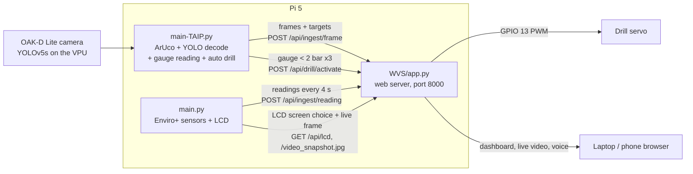

# UAVPayloadTAQ: System Guide and Operating Manual

EGH455 Group 23. Branch `taip-yolo-integration`.

The payload flies on the X500 and, without operator input:

- detects **valves** (open/closed), the **air pressure gauge** (and reads its value) and **ArUco markers** (pose and UAV position),
- measures **air quality** (temperature, humidity, pressure, light, gases),
- shows everything live on a **web dashboard** and on the **Enviro+ LCD**,
- **drills** the kinetic sand once the gauge reads **below 2 bar**, then retracts.

Hardware: Raspberry Pi 5, OAK-D Lite camera, Pimoroni Enviro+ (sensors + LCD), DF15RSMG 360° servo (drill), QUT PiPower board.

---

## 1. How the parts fit together

Three programs run on the Pi at the same time. They only talk to each other over HTTP on the Pi itself (`127.0.0.1:8000`).



| Program | Subsystem | What it does | Python environment |
|---|---|---|---|
| `main-TAIP.py` | TAIP (target acquisition & image processing) | Camera, ArUco pose, YOLO valves/gauge, needle reading, automatic drill trigger, sends frames to WVS | `~/enviroplus/env` |
| `main.py` | AQ (air quality) | Reads the Enviro+ sensors, drives the LCD, sends readings to WVS | `~/enviroplus/env` (needs `bme280`, `st7735`) |
| `WVS/app.py` | WVS (web visualisation) + EDM (drill) | Dashboard, live feed, storage, LCD menu, runs the drill servo | `~/enviroplus/env` (has Flask + gpiozero) |

Only one program can open the camera at a time, and only one can drive the LCD.

---

## 2. Target detection (TAIP)

### 2.1 Camera pipeline: `main-TAIP.py`

One camera, two outputs, both at `TAIP_CAMERA_FPS` (default 5):

| Output | Size | Used for |
|---|---|---|
| Frame | 640×480 BGR | ArUco (matches the calibration files), gauge crops, frames sent to WVS |
| NN input | 640×640, stretched | YOLO on the OAK-D VPU (same resize as training) |

Both keep the full field of view, so YOLO's normalised boxes map straight onto the 640×480 frame. **Keep both outputs at the same rate**: different rates stalled the pipeline after the first frame.

The main loop, `main()` at `main-TAIP.py:126`, does this each frame:

1. Logs the OAK-D chip temperature and loop/send rates every 30 s, and warns from 95 °C. The camera shuts down at 105 °C.
2. Gets the newest frame and the newest YOLO result.
3. Runs ArUco: `pose_estimation()` in `TAIP/pose_estimation.py:55`.
4. Converts YOLO boxes to targets, `to_targets()`, then reads each gauge: `read_gauges()` at `main-TAIP.py:79`.
5. Feeds gauge readings to the drill trigger: `DrillTrigger.update()`.
6. Hands the frame and all targets to `FrameSender` (`main-TAIP.py:49`), a background thread that posts to WVS and always sends the newest frame, so the loop never waits on the network.

### 2.2 YOLO model: `TAIP/yolo_detection.py`

| Item | Value |
|---|---|
| Model | YOLOv5s, 3 classes: `valve_open`, `valve_closed`, `gauge` |
| Files | `TAIP/models/best_openvino_2022.1_6shave.blob` (camera), `TAIP/models/best.pt` (PyTorch master copy) |
| Runs on | OAK-D Lite Myriad X VPU, about 7.5 fps max |
| Decoding | On the Pi: `decode()` at `yolo_detection.py:41` |
| Thresholds | valves 0.5 (`TAIP_CONF`), gauge 0.15 (`TAIP_GAUGE_CONF`), NMS IoU 0.5 |
| Anchors | YOLOv5 defaults, line 31 (AutoAnchor kept them) |

Why decoding happens on the Pi: the blob outputs three raw YOLO heads. depthai 3.10's built-in YOLO parser crashed the camera with this blob, while the plain `NeuralNetwork` node runs it cleanly. So `add_yolo()` (line 98) runs the blob on the VPU, and `decode()` turns the heads into boxes with the same maths as YOLOv5. It was checked against YOLOv5 on 134 real arena frames: identical boxes.

Why the gauge threshold is lower: the blue gauge below about 2 bar scored under 0.5. That also stopped the auto drill. A false gauge box is still dropped unless its dial and needle can be read.

**Test results** (Roboflow v4, 97 held-out images): all mAP50 0.985 / mAP50-95 0.720. valve_open 0.995 / 0.612, valve_closed 0.964 / 0.626, gauge 0.995 / 0.921.

### 2.3 Gauge reading: `TAIP/gauge_processing.py`

`read_gauges()` crops each YOLO gauge box with 10% padding, then:

1. `detect_gauge_type()` (line 54) decides blue or white from how much of the crop is blue. `BLUE_FRACTION_THRESHOLD = 0.15`, line 51; calibrate on real crops.
2. `process_gauge()` (line 430) finds the dial with `HoughCircles` (radius 30–60% of the crop) and the needle with `HoughLinesP`. It uses `detect_white_needle()` (line 75) or `detect_blue_needle()` (line 231), then converts the angle to bar with `GAUGE_SETTINGS` (line 18):

| Gauge | Zero angle | Range | Max |
|---|---|---|---|
| white | 231.5° | 275° | 10 bar |
| blue | 222.0° | 270° | 10 bar |

A gauge whose needle can't be read is left out of that frame, because WVS rejects a gauge without a value. Crops under 40 px are skipped.

### 2.4 ArUco: `TAIP/pose_estimation.py`

`DICT_5X5_100`, 200 mm markers, calibration `TAIP/oak_calibration_matrix_640x480.npy` and `oak_distortion_coefficients_640x480.npy`. It gives the marker pose relative to the camera (x, y, z) and the UAV reference point relative to the marker.

---

## 3. Drill (EDM)

| File | What |
|---|---|
| `EDM/auto_trigger.py` | `DrillTrigger` (line 51): after 3 gauge readings in a row below 2.0 bar, it fires the drill once per run through WVS |
| `EDM/drill_controller.py` | `activate_drill()` (line 29): drives the servo on GPIO 13 with gpiozero. Down → pause → retract, with a lock so it can't run twice at once |
| `WVS/api/routes.py:167` | `POST /api/drill/activate`, used by both the dashboard button and the auto trigger, so only the WVS process drives the servo |

Sequence: `DRILL_SPEED` (+1.0) for `DRILL_SECONDS` (5 s), stop for 1 s, `RETRACT_SPEED` (−1.0) for `RETRACT_SECONDS` (5 s), stop, PWM off.

Requirement: a 15 mm deep × 15 mm wide hole, then retract to the start. **Calibrate the times** on the real mechanism; see the manual.

**Power:** the servo header (M1) on the QUT PiPower board needs the board's own supply. With only the Pi powered, the servo doesn't move even though the code runs. Header pins, top to bottom: `~` signal (yellow), `+` (red), `−` (brown).

---

## 4. Air quality and LCD (AQ)

| File | What |
|---|---|
| `main.py` | Loop: reads sensors, updates the LCD, sends a reading to WVS every 4 s (`WVS_INGEST_INTERVAL`) |
| `AQ/sensor_interface.py` | BME280 (temperature with CPU-heat correction, humidity, pressure), LTR559 (light, proximity), MICS6814 gases (oxidising, reducing, NH3) |
| `AQ/display_controller.py` | ST7735 160×80 LCD with 3 screens: **IP address**, **temperature** (Enviro + Pi CPU graph), **detection** (live TAQ feed) |

Switching screens: wave a hand over the proximity sensor, or use the dashboard's **Payload LCD** menu (`GET /api/lcd`, polled every 2 s). The detection screen, `show_taq_feed()` at line 282, shows `GET /video_snapshot.jpg` from WVS three times a second, with the boxes drawn.

---

## 5. Web server (WVS)

`WVS/app.py`, Flask on port 8000. Start with `WVS_USE_DB=0` to keep data in memory; it needs no MariaDB.

| Endpoint | Purpose |
|---|---|
| `/` | Dashboard: live video, identified targets, air quality charts, logged data, image history, system log, voice alerts |
| `/video_feed` | MJPEG live stream, boxes drawn by WVS |
| `/video_snapshot.jpg` | Newest frame (used by the LCD); 503 when there's no live feed |
| `POST /api/ingest/frame` | Frame and targets from TAIP |
| `POST /api/ingest/reading` | Air quality reading from AQ |
| `POST /api/ingest/drill` | Drill panel state (`drilling` / `done`) |
| `POST /api/drill/activate` | Runs the drill |
| `GET/POST /api/lcd` | LCD screen chosen on the dashboard |
| `/api/status`, `/healthz` | Health checks: frame count, fps, rows stored |

Validation lives in `WVS/ingestion/checks.py`. A detection needs `type` = valve (with `valve_state`), gauge (with `gauge_value`) or aruco (with `id`).

---

## 6. Training pipeline (reference)

| Step | Where |
|---|---|
| Label in Roboflow, project `egh455-epcw7-vi0yr`, classes Valve Open / Valve Close / Gauge | app.roboflow.com |
| Generate a version: Auto-Orient, Stretch 640×640, brightness ±25%, blur 1 px, noise 2%, 3× | Roboflow → Versions |
| Train in Colab: download, strip/rename classes, YOLOv5s 100 epochs, test-split eval | `TAIP/training/EGH455_train_real.ipynb` |
| Map Roboflow class names to the 3 classes | `TAIP/training/strip_classes.py` |
| Convert `best.pt` to the OAK-D blob (three raw heads) | `TAIP/training/export_oakd.py` (run inside a yolov5 v7.0 checkout) |

Do **not** use the `.blob` the notebook's `export.py` cell makes. It has the wrong output format for this pipeline.

---

## 7. Operating manual

### 7.1 Connect to the Pi

The Pi's IP is on the Enviro+ LCD's IP screen (it was `10.88.61.45`).

```bash
ssh egh455group23@10.88.61.45
```

### 7.2 Update the code on the Pi

From GitHub (needs a token on the Pi):
```bash
cd ~/UAVTAQ-yolo && git pull
```
Or from a Mac that has the bundle:
```bash
# on the Mac
scp ~/Downloads/UAVTAQ-yolo.tar.gz egh455group23@10.88.61.45:~/
# on the Pi
cd ~ && rm -rf ~/UAVTAQ-yolo && tar xzf UAVTAQ-yolo.tar.gz
```

### 7.3 Before starting

1. Camera in a **blue USB3 port**, with airflow around it:
   ```bash
   lsusb | grep 03e7        # must show Intel Movidius MyriadX
   ```
2. Servo powered through the PiPower board's own supply.
3. Nothing old still running:
   ```bash
   pkill -f "app.py"; pkill -f "main-TAIP.py"; pkill -f "UAVTAQ-PAYLOAD/main.py"
   ```

### 7.4 Start the system: three SSH windows, in this order

**Window 1, web server and drill**
```bash
source ~/enviroplus/env/bin/activate && cd ~/UAVTAQ-yolo/WVS && WVS_USE_DB=0 python3 app.py
```
Wait for `Running on http://10.88.61.45:8000`.

**Window 2, air quality and LCD**
```bash
source ~/enviroplus/env/bin/activate && cd ~/UAVTAQ-yolo && python3 main.py
```

**Window 3, camera, detection and auto drill**
```bash
source ~/enviroplus/env/bin/activate && cd ~/UAVTAQ-yolo && python3 main-TAIP.py | tee /tmp/taip.log
```
It prints `TAIP running ... Drill fires below 2.0 bar`, then the chip temperature every 30 s.

**Ground station:** open `http://10.88.61.45:8000` on any laptop or phone on the same network.

### 7.5 Check that it works

| Check | Expected |
|---|---|
| Dashboard live feed | moving image, capture lag well under 4 s |
| Valve in view | box labelled valve open or closed, voice alert |
| Gauge in view | box with value in bar, within ±0.2 bar of the dial |
| ArUco marker | marker ID and position chart |
| Air quality charts | update every 4 s |
| LCD | proximity wave cycles IP → temperature → live detection |
| Gauge below 2 bar | window 3: `[drill] ... starting drill`; servo down, pause, up; drill panel "done" |

Live log of gauge readings and the drill:
```bash
tail -f /tmp/taip.log | grep -E "Pressure:|\[drill\]|chip temperature|TAIP\]"
```

### 7.6 Stop

Press Ctrl+C in each window. The auto drill fires **once per run**; restart window 3 to arm it again.

### 7.7 Settings (environment variables)

Put them in front of the command, e.g. `TAIP_CAMERA_FPS=6 python3 main-TAIP.py`.

| Variable | Default | Program | Meaning |
|---|---|---|---|
| `TAIP_CAMERA_FPS` | 5 | main-TAIP | Camera and model rate (model max ~7.5; above 6 the camera runs hot) |
| `TAIP_CONF` | 0.5 | main-TAIP | Valve confidence threshold |
| `TAIP_GAUGE_CONF` | 0.15 | main-TAIP | Gauge confidence threshold |
| `TAIP_SHOW` | 0 | main-TAIP | 1 = local preview window (needs a screen) |
| `WVS_FRAME_INTERVAL` | 0 | main-TAIP | Seconds between frames sent to WVS (0 = every frame) |
| `WVS_DRILL_BAR` | 2.0 | main-TAIP, WVS | Drill threshold (bar) |
| `DRILL_CONFIRM_READINGS` | 3 | main-TAIP | Readings in a row below the threshold before firing |
| `DRILL_SECONDS` / `RETRACT_SECONDS` | 5 / 5 | WVS | Drill-down and retract time |
| `DRILL_SPEED` / `RETRACT_SPEED` | 1.0 / −1.0 | WVS | Servo speed and direction (swap the signs if it drills upward) |
| `DRILL_SERVO_PIN` | 13 | WVS | Servo GPIO |
| `WVS_USE_DB` | 1 | WVS | 0 = no MariaDB, data in memory |

Calibrating the drill, for example:
```bash
DRILL_SECONDS=4 RETRACT_SECONDS=4 WVS_USE_DB=0 python3 app.py
```

### 7.8 Useful single tests

```bash
# model alone, prints detections (stop main-TAIP.py first)
source ~/enviroplus/env/bin/activate && cd ~/UAVTAQ-yolo && python3 -m TAIP.detect_oakd

# drill alone, 2 s each way (stop the web server first, it owns GPIO 13)
cd ~/UAVTAQ-yolo && DRILL_SECONDS=2 RETRACT_SECONDS=2 ~/enviroplus/env/bin/python3 -m EDM.drill_controller

# sensors alone, 15 s (stop main.py first)
cd ~/UAVTAQ-yolo && timeout 15 ~/enviroplus/env/bin/python3 -u -m AQ.sensor_interface

# web server health
curl -s localhost:8000/api/status | python3 -m json.tool | head -30
```

### 7.9 Troubleshooting

| Symptom | Cause | Fix |
|---|---|---|
| `RuntimeError: No available devices` | Camera in use or not connected | `pgrep -af main-TAIP` and kill it; `lsusb \| grep 03e7`; replug in a blue port |
| `X_LINK_ERROR`, "device has crashed" | Overheating (>105 °C) or USB/power drop | Unplug, cool down, give airflow; keep `TAIP_CAMERA_FPS` at 5 |
| "Temperature above 105C" | Camera too hot | Stop, cool, add airflow or a fan |
| Feed shows one frame, then nothing | Camera outputs at different rates | Don't set different rates; use `TAIP_CAMERA_FPS` only |
| `GPIO9 ... claimed by main-st7735-dc` | Another `main.py` has the LCD | `pkill -f "UAVTAQ-PAYLOAD/main.py"`, then start `main.py` again |
| No live feed on dashboard | `main-TAIP.py` not running, or WVS not running | Start window 1 first, then window 3 |
| `Connection refused` on port 8000 | WVS not running | Start window 1 |
| `No module named 'bme280'` | Wrong environment | `source ~/enviroplus/env/bin/activate` |
| `source~/...: No such file` | Missing space after `source` | `source ~/enviroplus/...` |
| Servo doesn't move, code says done | No power on the servo header | Power the PiPower board; check connector orientation |
| Drill doesn't fire below 2 bar | Gauge not detected or not read near 2 bar | Watch `Pressure:` lines in `/tmp/taip.log`; lower `TAIP_GAUGE_CONF` |
| Gauge box missing | Needle couldn't be read (WVS needs a value) | Check `/tmp/taip.log` for "needle not detected" / "outside gauge range" |
